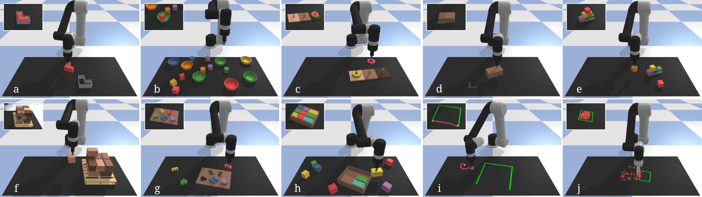

# Ravens - Transporter Networks

Ravens is a collection of simulated tasks in PyBullet for learning vision-based robotic manipulation, with emphasis on pick and place.
It features a Gym-like API with 10 tabletop rearrangement tasks, each with (i) a scripted oracle that provides expert demonstrations (for imitation learning), and (ii) reward functions that provide partial credit (for reinforcement learning).

<br>

(a) **block-insertion**: pick up the L-shaped red block and place it into the L-shaped fixture.<br>
(b) **place-red-in-green**: pick up the red blocks and place them into the green bowls amidst other objects.<br>
(c) **towers-of-hanoi**: sequentially move disks from one tower to another—only smaller disks can be on top of larger ones.<br>
(d) **align-box-corner**: pick up the randomly sized box and align one of its corners to the L-shaped marker on the tabletop.<br>
(e) **stack-block-pyramid**: sequentially stack 6 blocks into a pyramid of 3-2-1 with rainbow colored ordering.<br>
(f) **palletizing-boxes**: pick up homogeneous fixed-sized boxes and stack them in transposed layers on the pallet.<br>
(g) **assembling-kits**: pick up different objects and arrange them on a board marked with corresponding silhouettes.<br>
(h) **packing-boxes**: pick up randomly sized boxes and place them tightly into a container.<br>
(i) **manipulating-rope**: rearrange a deformable rope such that it connects the two endpoints of a 3-sided square.<br>
(j) **sweeping-piles**: push piles of small objects into a target goal zone marked on the tabletop.<br>

Some tasks require generalizing to unseen objects (d,g,h), or multi-step sequencing with closed-loop feedback (c,e,f,h,i,j).

**Team:** this repository is developed and maintained by [Andy Zeng](https://andyzeng.github.io/), [Pete Florence](http://www.peteflorence.com/), [Daniel Seita](https://people.eecs.berkeley.edu/~seita/), [Jonathan Tompson](https://jonathantompson.github.io/), and [Ayzaan Wahid](https://www.linkedin.com/in/ayzaan-wahid-21676148/). This is the reference repository for the paper:

### Transporter Networks: Rearranging the Visual World for Robotic Manipulation
[Project Website](https://transporternets.github.io/)&nbsp;&nbsp;•&nbsp;&nbsp;[PDF](https://arxiv.org/pdf/2010.14406.pdf)&nbsp;&nbsp;•&nbsp;&nbsp;Conference on Robot Learning (CoRL) 2020

*Andy Zeng, Pete Florence, Jonathan Tompson, Stefan Welker, Jonathan Chien, Maria Attarian, Travis Armstrong,<br>Ivan Krasin, Dan Duong, Vikas Sindhwani, Johnny Lee*

**Abstract.** Robotic manipulation can be formulated as inducing a sequence of spatial displacements: where the space being moved can encompass an object, part of an object, or end effector. In this work, we propose the Transporter Network, a simple model architecture that rearranges deep features to infer spatial displacements from visual input—which can parameterize robot actions. It makes no assumptions of objectness (e.g. canonical poses, models, or keypoints), it exploits spatial symmetries, and is orders of magnitude more sample efficient than our benchmarked alternatives in learning vision-based manipulation tasks: from stacking a pyramid of blocks, to assembling kits with unseen objects; from manipulating deformable ropes, to pushing piles of small objects with closed-loop feedback. Our method can represent complex multi-modal policy distributions and generalizes to multi-step sequential tasks, as well as 6DoF pick-and-place. Experiments on 10 simulated tasks show that it learns faster and generalizes better than a variety of end-to-end baselines, including policies that use ground-truth object poses. We validate our methods with hardware in the real world.

## Installation

**Step 1.** Recommended: install [Miniconda](https://docs.conda.io/en/latest/miniconda.html) with Python 3.7.

```shell
curl -O https://repo.anaconda.com/miniconda/Miniconda3-latest-Linux-x86_64.sh
bash Miniconda3-latest-Linux-x86_64.sh -b -u
echo $'\nexport PATH=~/miniconda3/bin:"${PATH}"\n' >> ~/.profile  # Add Conda to PATH.
source ~/.profile
conda init
```

**Step 2.** Create and activate Conda environment, then install GCC and Python packages.

```shell
cd ~/ravens
conda create --name ravens python=3.7 -y
conda activate ravens
sudo apt-get update
sudo apt-get -y install gcc libgl1-mesa-dev
pip install -r requirements.txt
python setup.py install --user
```

**Step 3.** Recommended: install GPU acceleration with NVIDIA [CUDA](https://developer.nvidia.com/cuda-toolkit) 10.1 and [cuDNN](https://developer.nvidia.com/cudnn) 7.6.5 for Tensorflow.
```shell
./oss_scripts/install_cuda.sh  #  For Ubuntu 16.04 and 18.04.
conda install cudatoolkit==10.1.243 -y
conda install cudnn==7.6.5 -y
```

### Alternative: Pure `pip`

As an example for Ubuntu 18.04:

```shell
./oss_scipts/install_cuda.sh  #  For Ubuntu 16.04 and 18.04.
sudo apt install gcc libgl1-mesa-dev python3.8-venv
python3.8 -m venv ./venv
source ./venv/bin/activate
pip install -U pip
pip install scikit-build
pip install -r ./requirements.txt
export PYTHONPATH=${PWD}
```

## Getting Started

**Step 1.** Generate training and testing data (saved locally). Note: remove `--disp` for headless mode.

```shell
python ravens/demos.py --assets_root=./ravens/environments/assets/ --disp=True --task=block-insertion --mode=train --n=10
python ravens/demos.py --assets_root=./ravens/environments/assets/ --disp=True --task=block-insertion --mode=test --n=100
```

To run with shared memory, open a separate terminal window and run `python3 -m pybullet_utils.runServer`. Then add `--shared_memory` flag to the command above.

**Step 2.** Train a model e.g., Transporter Networks model. Model checkpoints are saved to the `checkpoints` directory. Optional: you may exit training prematurely after 1000 iterations to skip to the next step.

```shell
python ravens/train.py --task=block-insertion --agent=transporter --n_demos=10
```

**Step 3.** Evaluate a Transporter Networks agent using the model trained for 1000 iterations. Results are saved locally into `.pkl` files.

```shell
python ravens/test.py --assets_root=./ravens/environments/assets/ --disp=True --task=block-insertion --agent=transporter --n_demos=10 --n_steps=1000
```

**Step 4.** Plot and print results.

```shell
python ravens/plot.py --disp=True --task=block-insertion --agent=transporter --n_demos=10
```

**Optional.** Track training and validation losses with Tensorboard.

```shell
python -m tensorboard.main --logdir=logs  # Open the browser to where it tells you to.
```

## Parallel-Jaw Block Stacking

The `stack-block-pyramid-parallel-jaw` task uses a directly mounted,
two-prismatic-finger kinematic gripper instead of the suction end effector.
Generate demonstrations with:

```shell
python -m ravens.demos --assets_root=./ravens/environments/assets/ --task=stack-block-pyramid-parallel-jaw --mode=train --n=100
python -m ravens.demos --assets_root=./ravens/environments/assets/ --task=stack-block-pyramid-parallel-jaw --mode=test --n=100
```

Train and evaluate a task-specific Transporter checkpoint with:

```shell
python -m ravens.train --task=stack-block-pyramid-parallel-jaw --agent=transporter --n_demos=100
python -m ravens.test --assets_root=./ravens/environments/assets/ --task=stack-block-pyramid-parallel-jaw --agent=transporter --n_demos=100 --n_steps=40000
```

The gripper is mounted directly on the UR5 wrist and its fingers visibly close
to the selected object's width. Because Ravens moves the arm kinematically,
grasp eligibility is checked inside the jaw volume and a temporary PyBullet
constraint carries the object until the fingers open. This avoids unstable
collision impulses while still rejecting picks that are not between the jaws.

The trained parallel-jaw checkpoint, evaluation commands, and final metrics
are available in [`models/parallel-jaw-v2`](models/parallel-jaw-v2) and the
[`completion report`](docs/parallel-jaw-v2-completion-report.md).

### RGB-D Grasp Quality Learning

The current grasping technique is a **hybrid depth-geometry + learned grasp-Q
approach** for top-down parallel-jaw grasps:

```text
RGB-D cameras
    -> fused color heightmap
    -> depth components propose object centers, principal-axis yaw, and width
    -> candidate-Q scores aligned local RGB-D crops and penalizes uncertainty
    -> robot executes the highest-ranked grasp
    -> CEM / beam search plans object order and placement
```

The geometry stage prevents the neural network from selecting arbitrary
background pixels or unsupported yaw/width combinations. The learned stage
uses scene appearance and depth to choose between the proposed grasps.

#### Training labels

The collector samples successful and failed grasp attempts. An attempt is
positive only when an object remains attached and is lifted by at least 5 cm.
Each sample stores the fused RGB-D heightmap, grasp pixel, yaw, jaw width,
grasped object, measured lift height, timeout state, and lift outcome.

#### Commands

```shell
python -m ravens.collect_grasp_data --assets_root=./ravens/environments/assets/ --attempts=1000 --output_dir=./data/rgbd-grasp-attempts-train
python -m ravens.collect_grasp_data --assets_root=./ravens/environments/assets/ --attempts=200 --seed=20000 --output_dir=./data/rgbd-grasp-attempts-validation
python -m ravens.train_grasp_candidate_q --candidate_data_dir=./data/rgbd-grasp-attempts-train --candidate_steps=1500 --gpu_limit=5
python -m ravens.eval_grasp_candidate_q --candidate_eval_data_dir=./data/rgbd-grasp-attempts-validation --candidate_checkpoint=./runs/grasp-candidate-q/checkpoints/grasp-candidate-q-750.h5 --gpu_limit=5
python -m ravens.beam_test --task=stack-block-pyramid-parallel-jaw --n=10 --grasp_checkpoint=./runs/grasp-candidate-q/checkpoints/grasp-candidate-q-750.h5 --grasp_weight=0.1
python -m ravens.cem_test --task=stack-block-pyramid-parallel-jaw --n=100 --n_samples=24 --n_elites=5 --n_iters=3 --verify_k=3
```

The planners now share an explicit grasp-policy adapter. `geometry` preserves
the native object-center pick, `candidate_q` loads the learned checkpoint, and
`analytic` uses a Dex-Net-inspired perturbation-robust geometry score (not the
Dex-Net GQ-CNN):

```bash
python -m ravens.beam_test --grasp_policy=analytic --grasp_gate=true
python -m ravens.cem_test --grasp_policy=analytic --grasp_rank_objects=true
python -m ravens.beam_test --grasp_policy=qt_opt --grasp_checkpoint=./runs/grasp-qt-opt/checkpoints/grasp-qt-opt-1500.h5
```

The adapter is the integration point for future point-cloud policies such as
GPD and Contact-GraspNet. See the
[`grasp-policy benchmark plan`](docs/grasp-policy-benchmark.md) for scope,
compatibility constraints, and current smoke-test results.

The point-cloud boundary is implemented and tested: it exports world-frame
points through an isolated NPZ subprocess protocol, filters external 6-DoF
proposals to top-down reachable grasps, and maps them back to planner objects.
Actual GPD and Contact-GraspNet inference still requires a separate compatible
Linux environment and pretrained weights; those dependencies are not installed
in the current Windows simulator environment.

#### Current status

- The first 80-train / 20-validation pilot reached 80% held-out accuracy and
  0.939 ROC AUC at 500 updates.
- Expanding training to 240 attempts improved yaw/width coverage but reached
  70% accuracy on the same small validation set, showing that checkpoint loss
  and dataset size alone do not guarantee better generalization.
- Unrestricted dense-map argmax failed in execution because sparsely supervised
  output locations became overconfident. Inference now ranks depth-derived
  grasp proposals and masks action bins without sufficient training coverage.
- The replacement candidate-conditioned CNN trains on balanced success/failure
  batches, rotates a 48 x 48 RGB-D crop into the proposed grasp frame, and uses
  Monte Carlo dropout to rank by mean success probability minus uncertainty.
  At 750 updates it reached 0.980 ROC AUC and 0.198 log loss on the same small
  20-attempt validation split (11 positive, 9 negative).
- An input-mutation bug initially made learned grasps execute at an invalid
  height; model preprocessing now copies the raw heightmap and has a regression
  test. After the fix, a 20-scene paired benchmark gave 20/20 lifts for learned
  Q ranking, random depth proposals, and privileged geometry. The benchmark is
  therefore saturated under the current kinematic grasp model and does not yet
  demonstrate an advantage for learning.
- Beam search can add candidate Q with a conservative `0.1` tie-break weight.
  The initial three-seed smoke comparison favored Q, but the full paired
  100-seed test did not: baseline mean reward was 0.515 and Q reached 0.495
  (paired delta -0.020, 95% bootstrap CI [-0.063, 0.025]). Q won on 18 seeds,
  tied on 58, and lost on 24; it also increased zero-reward episodes from 10
  to 14. The current grasp Q is therefore not better end-to-end and should be
  considered experimental rather than a default policy improvement.
  An uncertainty-gated variant recovered most of the loss but did not beat
  geometry-only beam: 0.510 versus 0.515 over 100 seeds (paired delta -0.005,
  bootstrap 95% CI [-0.037, 0.027]). It abstained on 449 of 1008 decisions.
  CEM has one predetermined object pick per step, so Q is diagnostic there and
  leaves the proven center pick unchanged by default. Experimental pose
  replacement is available via `--grasp_refine_pose`, but performed poorly.
  Uncertainty-gated Q object reordering is available through
  `--grasp_rank_objects`. Over the complete 100-seed test it reached 0.678
  versus 0.673 for standard CEM (paired delta +0.005, bootstrap 95% CI
  [-0.038, 0.045]). This is not a measurable improvement, so it remains
  disabled by default.
- Standard CEM is the current recommended policy. On the same 100 held-out
  seeds it reached 0.673 mean reward with 55 full stacks, improving over the
  reduced-beam baseline by +0.158 (paired bootstrap 95% CI [0.087, 0.230]).
  CEM + gated Q produced 58 full stacks and mean reward 0.678. The new robust
  analytic scorer reached the highest observed result: 0.710 with 59 full
  stacks and 9 zero-reward episodes. Its +0.037 paired gain over CEM was
  promising but unresolved (bootstrap 95% CI [-0.003, 0.080]), so standard CEM
  remains the default and analytic ranking remains experimental.
  CEM used substantially more planning compute: 714 simulator rollouts per
  episode versus 61 for beam, so this is a better operating point rather than
  a compute-matched algorithm comparison.
- The original grasp-Q checkpoints remain one-step immediate-reward models. A
  separate compact QT-Opt-style path now collects sequential RGB-D replay and
  trains Bellman targets with a target network. A 100-episode run produced
  1,054 transitions and trained for 1,500 updates. Its 10-seed beam safety
  screen scored 0.483 versus 0.500 for geometry (0 wins, 9 ties, 1 loss), so it
  was not advanced to 100 seeds. The current lift-and-clear RL objective is not
  sufficiently aligned with stacking reward.
- The placement-aware follow-up records complete pick-and-place actions and
  actual stacking returns. A 100-episode run produced 958 transitions and
  trained a joint RGB-D action critic for 1,500 updates. On ten matched seeds,
  Beam + joint Q improved from 0.500 to 0.600, while CEM + joint Q regressed
  from 0.683 to 0.600 at weight 0.5. Beam advances to the full evaluation;
  CEM requires a smaller weight or an uncertainty gate first. A subsequent
  three-model, top-five gated CEM reranker safely reproduced native CEM at
  0.683 on all ten seeds, but accepted no changes. The next critic dataset must
  target hard, near-tied CEM candidate pairs rather than generic placements.
- A counterfactual CEM collector now records those hard pairs without changing
  the real episode. Its 20-episode pilot produced 995 candidate transitions and
  298 preference pairs. Pairwise fine-tuning improved held-out ranking accuracy
  from 0.517 to 0.550, which is not yet reliable enough to control CEM; a
  candidate-relative ranker is the next model step.
- The candidate-relative ranker is now implemented and planner-integrated. Its
  scratch and pretrained variants reached only 0.500 and 0.483 held-out
  accuracy respectively despite higher training accuracy. A high-confidence
  one-seed diagnostic safely fell back to native CEM. Expanding the replay from
  20 to 60 scenes and holding out 12 complete scenes raised validation accuracy
  to 0.649 (148 preference pairs). However, both 0.80 and 0.65 confidence gates
  reproduced native CEM exactly on ten seeds: 0.683 mean reward, 5 full and 5
  partial stacks. The ranker therefore remains disabled: it generalizes better
  offline, but is not yet calibrated strongly enough to improve planning.
- On the separate 100-scene heterogeneous-tower benchmark, the saved native
  CEM baseline is already near saturation at 0.986 mean completion reward (92
  full stacks, 8 partial, 0 failures). A matched CEM + analytic run used the
  same scenes and seeds and produced exactly the same result: 0 wins, 100 ties,
  and 0 losses. The analytic gate made 0 object-order changes over 497 calls
  (44 abstentions), so it safely preserved CEM but did not improve this easier
  completion-fraction benchmark.

#### Geometric vs Analytic Grasping

Run both policies on the same scene and seed with:

```powershell
conda activate ravens-transporter
python tools/run_grasp_policy_demo.py --policies geometry analytic --episodes 1 --refine-pose --gui
```

`geometry` uses the native object-center grasp, while `analytic` scores
perturbation-robust RGB-D grasp candidates. Results and summary CSV files are
written to `results/grasp-policy-demo/`. Remove `--gui` for a headless run, or
increase `--episodes` for a larger comparison. The underlying
`cem_hetero_towers.py` CLI also accepts
`candidate_q`, `gpd`, and `contact_graspnet`; learned policies require
`--grasp-checkpoint`, while point-cloud policies require repeated
`--grasp-backend-arg` values for their external inference command.

Generate a harder comparison set with 6–8 objects, tighter clutter, randomized
initial yaw, narrower support margins, and more cylinders/triangular prisms:

```bash
python generate_stacking_ravens.py --episodes 100 --difficulty hard \
  --seed 5478 --out mixed-stacking-hard-test
python tools/run_grasp_policy_demo.py --data mixed-stacking-hard-test \
  --episodes 100 --refine-pose
```

### Interpreting the reported CEM scores

Scores from different rows below are **not directly comparable** because the
scene difficulty and gripper assumptions change. Reward is the mean fraction
of objects successfully stacked in each episode.

| Benchmark | Gripper conditions | Original CEM | Best CEM + grasping | Meaning |
| --- | --- | ---: | ---: | --- |
| Easier heterogeneous, 100 scenes | Ideal rigid attachment | 0.986 | 0.986 | Near-saturated; grasp ranking had no room to help. |
| Hard heterogeneous, 100 scenes | Ideal rigid attachment | 0.963 | 0.975 | Grasp refinement gave a small, statistically supported gain. |
| Hard robustness, 100 scenes | 4 mm position noise, 7-degree yaw noise, slip | 0.694 | 0.704 | Grasping alone helped slightly, but its paired interval crossed zero. |
| Hard robustness + recovery | Same noise/slip, one regrasp allowed | 0.694 | **0.758** | Best current robust result; recovery prevents many early failures. |

Therefore, the project still achieves `0.9+` under the original ideal-gripper
conditions. The lower robust scores do not represent a regression: they come
from adding execution noise and grasp slip that were absent from the original
simulation. Compare algorithm improvements only within the same benchmark row.
The earlier 0.673/0.710 planner results elsewhere in this README also use a
different dataset and evaluation objective.

A 100-scene hard benchmark (`seed=5478`) contained 685 objects. Geometry scored
0.963 (88 full, 10 partial, 2 zero), while both analytic and QT-Opt pose
refinement scored 0.975 (95 full, 3 partial, 2 zero). Each refined policy had 10
wins, 87 ties, and 3 losses against geometry, a mean paired gain of +0.0124.
The paired bootstrap interval [0.0009, 0.0253] excludes zero, providing evidence
of a small improvement on this fixed test distribution. Analytic and QT-Opt
produced identical episode outcomes here, so this benchmark does not establish
that the learned policy is better than the analytic one. The remaining
limitation is the constraint-assisted gripper: every centered width-feasible
proposal attaches rigidly, so contact/slip and grasp perturbation models are
still needed to discriminate grasp quality more strongly.

To evaluate grasp robustness instead of ideal fixed-constraint attachment, add
seeded execution noise and quality-dependent slip to the same matched scenes:

```bash
python tools/run_grasp_policy_demo.py --data mixed-stacking-hard-test \
  --episodes 100 --refine-pose \
  --grasp-position-noise-mm 4 --grasp-yaw-noise-degrees 7 \
  --grasp-slip-scale 0.5 --output-dir results/grasp-robust-hard-100
```

The disturbance is keyed by episode seed and object ID, so every policy sees
the same position/yaw error and slip draw for a given object. Each action saves
the modeled grasp quality, slip probability, applied perturbation, and outcome
reason under `grasp_robustness`. Setting all three robustness options to zero
preserves the original geometry-gated behavior.

On the 100 hard scenes above, using 4 mm position noise, 7-degree yaw noise,
and a 0.5 slip scale removed the ceiling effect. Geometry scored 0.694 (54
full, 31 partial, 15 zero), analytic refinement scored 0.704 (58 full, 26
partial, 16 zero), and QT-Opt refinement scored 0.702 (57 full, 27 partial, 16
zero). The paired gains over geometry were +0.0092 for analytic and +0.0075 for
QT-Opt, but their bootstrap intervals [-0.0291, 0.0464] and [-0.0308, 0.0450]
cross zero. Analytic beat QT-Opt on one scene and tied it on 99, so the learned
checkpoint still does not improve on the analytic policy. Robustness-aware
training data, rather than additional evaluation alone, remains useful.

CEM can also recover once from a modeled slip, center miss, or jaw-width
failure. The recovery recenters on the object, selects the better of two
orthogonal jaw directions, and adjusts placement yaw to preserve the object
orientation that CEM planned:

```bash
python tools/run_grasp_policy_demo.py --data mixed-stacking-hard-test \
  --episodes 100 --refine-pose --grasp-retries 1 \
  --grasp-position-noise-mm 4 --grasp-yaw-noise-degrees 7 \
  --grasp-slip-scale 0.5 --output-dir results/cem-grasp-retry-hard-100
```

On the same 100 scenes, CEM + analytic + one retry improved mean reward from
0.704 to 0.758. It produced 58 full, 33 partial, and 9 zero-reward scenes,
versus 58, 26, and 16 without retry. The paired gain was +0.0545 with a 95%
bootstrap interval [0.0131, 0.1024]: 12 wins, 80 ties, and 8 losses. Of 43
recovery attempts, 11 succeeded. QT-Opt + retry produced identical results, so
the analytic policy remains the simpler choice. Recovery improves progress and
reduces catastrophic early failure, but does not yet increase the full-stack
count; the next objective should explicitly reward complete towers.

See the [`RGB-D grasp learning guide`](docs/rgbd-grasp-learning.md) for the
dataset format, training options, selection benchmark, and simulator
limitations. Pilot measurements are in the
[`RGB-D grasp-Q pilot report`](docs/rgbd-grasp-pilot-results.md).

## Datasets and Pre-Trained Models

Download our generated train and test datasets and pre-trained models.

```shell
wget https://storage.googleapis.com/ravens-assets/checkpoints.zip
wget https://storage.googleapis.com/ravens-assets/block-insertion.zip
wget https://storage.googleapis.com/ravens-assets/place-red-in-green.zip
wget https://storage.googleapis.com/ravens-assets/towers-of-hanoi.zip
wget https://storage.googleapis.com/ravens-assets/align-box-corner.zip
wget https://storage.googleapis.com/ravens-assets/stack-block-pyramid.zip
wget https://storage.googleapis.com/ravens-assets/palletizing-boxes.zip
wget https://storage.googleapis.com/ravens-assets/assembling-kits.zip
wget https://storage.googleapis.com/ravens-assets/packing-boxes.zip
wget https://storage.googleapis.com/ravens-assets/manipulating-rope.zip
wget https://storage.googleapis.com/ravens-assets/sweeping-piles.zip
```

The MDP formulation for each task uses transitions with the following structure:

**Observations:** raw RGB-D images and camera parameters (pose and intrinsics).

**Actions:** a primitive function (to be called by the robot) and parameters.

**Rewards:** total sum of rewards for a successful episode should be =1.

**Info:** 6D poses, sizes, and colors of objects.

## Data Generation, CEM and Beam Search

CEM/Beam can directly use generated **original `episode.json` folders**. Conversion to Ravens format is required for VLM.

### 1. Data generation

**Heterogeneous towers** — generate episodes for tower stacking scenarios comprised of cubes, rectangles, cylinders and prisms.

```powershell
#Generated 100 train and test cases each for this project
python generate_stacking_ravens.py --episodes 100 --out mixed-stacking-validated
#Convert data to Ravens format
python replay_stacking_to_ravens.py --data mixed-stacking-validated --out data/mixed-stacking-validated-train
```

**Heterogeneous pyramids** — generate mixed 2–4-layer episodes for stacking scenarios comprised of cubes, rectangles, cylinders and prisms.

```powershell
#Generated 100 train and test cases each for this project
python generate_hetero_pyramids.py --episodes 100 --out hetero-pyramid-episodes
#Convert data to Ravens format
python convert_hetero_pyramids_to_ravens.py --data hetero-pyramid-episodes --out data/hetero-pyramid-train
```

The generators use simulated teleport placements, not verified robot grasps.

Data generated and used for this project can be found at this drive : https://drive.google.com/drive/folders/1Z7uG1NDutJdPRXKGZxVhiaGIU-9MwZH-?usp=sharing

### 2. Heterogeneous towers — CEM and Beam

```powershell
#able to modify configurations during run
python cem_hetero_towers.py --data mixed-stacking-validated --episodes 1 --samples 24 --iters 3 --elites 4 --gui
python beam_hetero.py --data mixed-stacking-validated --episodes 1 --beam-width 4 --gui
```

**Tuning** - compares CEM and Beam configurations:

```powershell
python tune_cem_beam_hetero.py --data mixed-stacking-validated --episodes 100
```

### 3. Heterogeneous pyramids — CEM and Beam

```powershell
#able to modify configurations during run
python cem_hetero_pyramid_height.py --data hetero-pyramid-episodes --layers 3 --episodes 1 --gui
python beam_hetero_pyramid_height.py --data hetero-pyramid-episodes --layers 3 --episodes 1 --beam-width 4 --gui
```

## VLM Stacking


Zero-shot VLM with the included parallel-jaw Transporter checkpoint (40,000 steps):

```
python -m vlm_stacking.run_ravens_sim --models-root "./models/parallel-jaw-v2" --planner zero-shot --instruction "Build a stable tower with the largest block at the bottom." --dry-run
```

Beam search planning
```
python -m vlm_stacking.run_ravens_sim \
  --planner beam --beam-width 3 --beam-horizon 2 \
  --instruction "Build a stable tower with the largest block at the bottom."
```

CEM search planning
```
python -m vlm_stacking.run_ravens_sim \
  --planner cem --cem-samples 24 --cem-elites 5 --cem-iterations 3 \
  --instruction "Build a stable tower with the largest block at the bottom."
```
